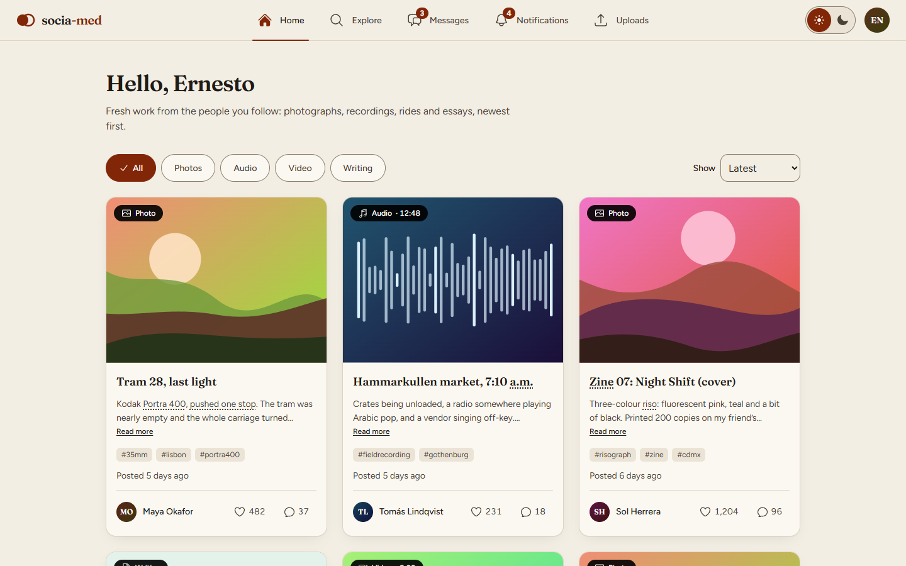
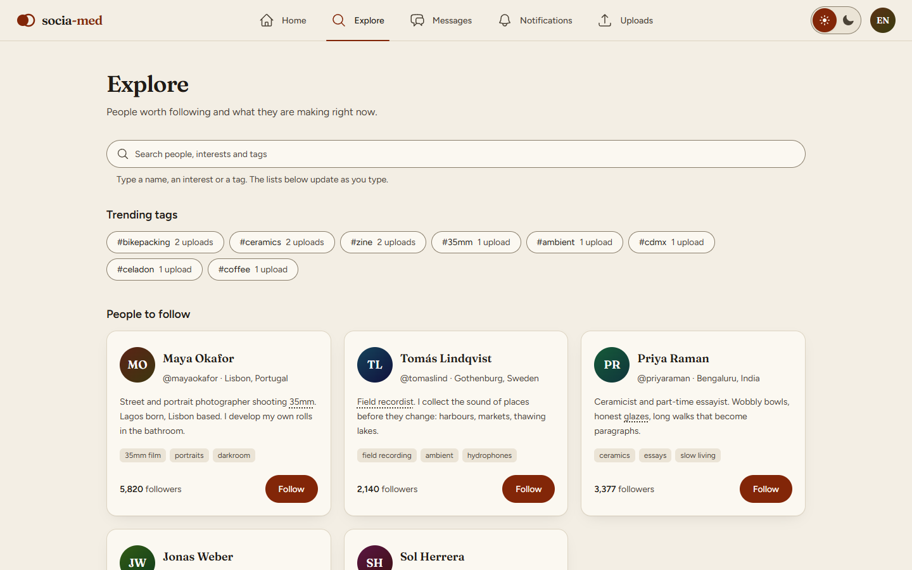
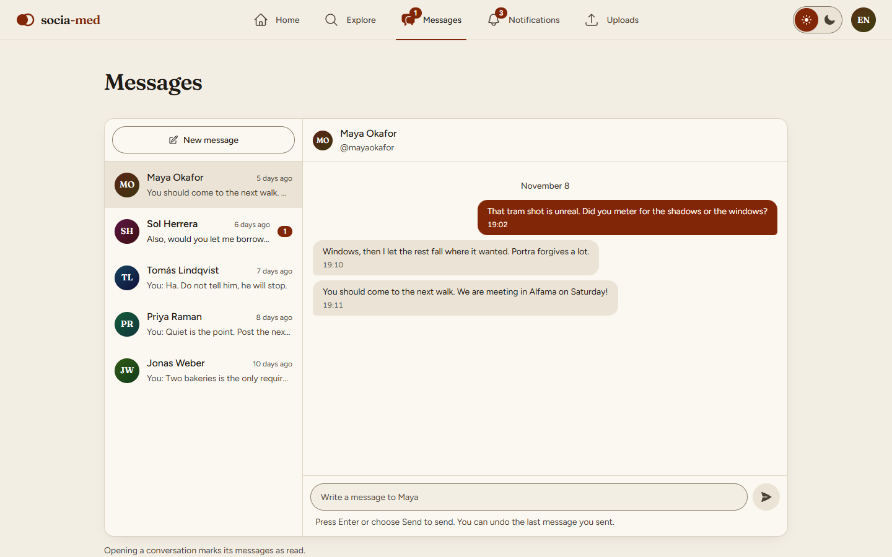
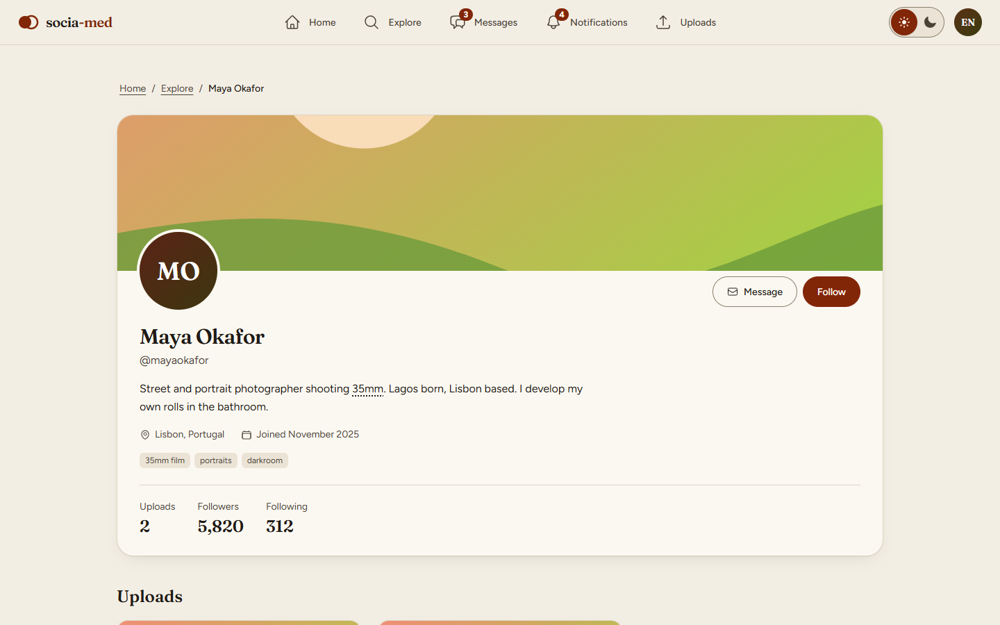
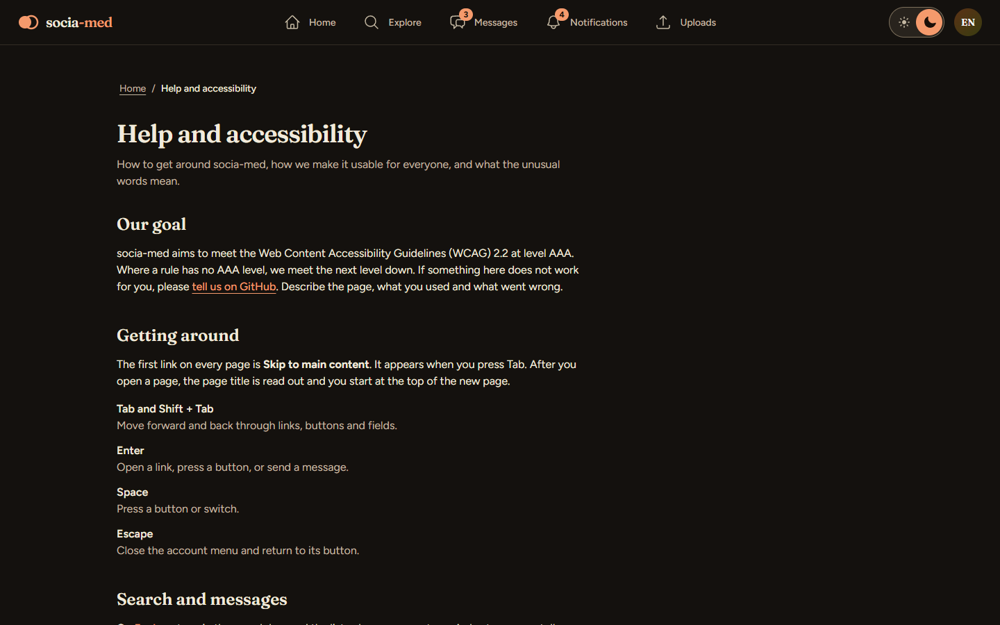

# socia-med

A social media app for sharing creative work: photographs, recordings, rides and essays. Follow people, explore what they are making, message them and keep track of uploads.

> **Status:** v0.2.0. The app reads and writes MongoDB through the Express API, and can be deployed as a live demo on Render. Run `npm run seed` once to fill an empty database with sample data; after that, changes made directly in MongoDB show up in the app the next time the tab is focused or reloaded.

## Try it

**Live demo: <https://socia-med-2oti.onrender.com>** – nothing to install and no account to make. Everyone who opens it acts as the same demo user, Ernesto, so you can click around freely: create, edit and delete posts from your profile, like, follow, and send messages. What you change is visible to everyone else who is trying it at the same time. The sample data is restored every 24 hours, so you can't break anything for long.

The demo runs on a free hosting tier that sleeps when idle, so the first load can take up to a minute. Photos, audio and video you attach may disappear before the post does, because the free disk is wiped on every restart and reset.

To run it yourself you need Node.js and a MongoDB database; see [Getting started](#getting-started). Then fill the database with the sample data using `npm run seed`. To host your own copy, see [Deploying a live demo](#deploying-a-live-demo-render).

## Screenshots

**Home** – recent work from the people you follow, filtered by photos, audio, video or writing.



**Explore** – trending tags and suggested people to follow.



**Messages** – conversations with unread counts, and the thread you have open.



**Profile** – bio, interests, follower count and everything a person has posted.



**Help and accessibility (dark theme)** – an accessibility statement, keyboard help and a glossary.



## Features

- **Home**: a feed of recent uploads from the people you follow.
- **Explore**: trending tags and suggested people to follow.
- **Messages**: conversation list and threads, with unread counts.
- **Notifications**: activity feed with an unread badge.
- **Uploads**: all uploads, or those of a single user.
- **Profiles**: bio, interests, follower count and uploads.
- **Posts**: create photo, audio, video and writing posts from your profile, and edit or delete your own.
- **Likes, follows and messages** are saved to the database.
- **Light and dark theme**, with a toggle in the header.
- **Help and accessibility**: an accessibility statement, keyboard help and a glossary.

## Accessibility

The target is [WCAG 2.2](https://www.w3.org/TR/WCAG22/) level **AAA**. Where a success criterion has no AAA level, the next level down (AA, then A) applies. Some AAA criteria cannot be met by the app alone; see "Known limits" below. The same text, for users, is on the Help page (`#/help`).

How the main criteria are met:

| Area | What the app does |
| ---- | ----------------- |
| Contrast (1.4.6, 1.4.11) | Text is at least 7:1 in both themes and control borders at least 3:1. The tokens in `src/index.css` are documented; recheck the ratios when you change one. Use `--edge` for control borders and `--line` only for decorative dividers. |
| Focus (2.4.7, 2.4.12, 2.4.13) | A 3px outline with a 2px gap, in the text colour. `scroll-padding-top` keeps focused items out from under the sticky header. Use `focus-visible:-outline-offset-4` for full-width links inside clipped containers. |
| Target size (2.5.5) | Buttons, switches and standalone links are at least 44 by 44 px (`min-h-11 min-w-11`). |
| Navigation (2.4.1, 2.4.2, 2.4.8, 2.4.9, 2.4.10) | Skip link, a title per page (set in `App.tsx`), breadcrumbs, link text that says where it goes, and a heading structure with no skipped levels. After in-app navigation focus moves to the page `<h1>`. |
| Reading (1.4.8, 3.1.3, 3.1.4) | Line height of 1.5 or more (set in the Tailwind theme), paragraph spacing, lines no longer than 80 characters, no abbreviations in visible text, and expandable definitions for jargon (`src/data/glossary.ts`). |
| Time and motion (2.2.2, 2.2.3, 2.3.3) | Nothing changes on a timer. Animation respects `prefers-reduced-motion`. |
| Status and errors (3.3.5, 3.3.6, 4.1.3) | Help text under inputs, live regions for results and sent messages (`Status` component), and "Undo send". |
| User settings (1.4.8, 1.4.12) | Works with forced colours, `prefers-contrast: more`, user text spacing and zoom to 400 per cent (320px wide) without sideways scrolling. |

When you add UI:

- Give every control a visible label that is part of its accessible name. Put extra context in an `sr-only` span after the visible text.
- Write numbers in full (`count()` in `src/lib/format.ts`) and times in words (`ago()`); add new jargon to the glossary.
- Never change content on a timer. Make submissions reversible or confirmable.
- Pass `label` to `Artwork` when it carries meaning; leave it out when it is decoration.

### Known limits

- Photos are described to screen readers only by their title, because the post form has no description field. Audio and video can be attached, but there is nowhere yet to add captions, transcripts, audio description or a sign-language version (1.2.x, AAA). The sample posts still use generated artwork.
- Text written by users (captions, messages) is not rewritten for reading level (3.1.5) or checked for idioms.
- Automated checks cannot prove AAA. Test with a screen reader and a keyboard before a release.

## Tech stack

- **Client:** React 19, TypeScript, Vite, Tailwind CSS 4, Heroicons, Figtree and Fraunces fonts
- **Server:** Express 5, Mongoose (MongoDB)
- **Tooling:** ESLint, `concurrently`

## Getting started

### Prerequisites

- Node.js 24 or later (the server runs `.ts` files directly and uses `--env-file`)
- A MongoDB database, for example a free [MongoDB Atlas](https://www.mongodb.com/atlas) cluster

### Setup

```bash
npm install
cp .env.example .env
```

Edit `.env` and set your connection string:

| Variable      | Description                          | Default |
| ------------- | ------------------------------------ | ------- |
| `MONGODB_URI` | MongoDB connection string (required) | none    |
| `PORT`        | Port for the API server              | `5189`  |
| `DEMO_RESET_HOURS` | Optional. Restore the sample data and delete attached files this often (see "Deploying a live demo") | off |

### Run

```bash
npm run dev
```

This starts both processes:

- Client: <http://localhost:5188>
- API: <http://localhost:5189>. Vite proxies `/api` to it, so `GET /api/health` also works through the client port.

The server exits on startup if `MONGODB_URI` is missing or the database is unreachable.

## Scripts

| Script            | What it does                                  |
| ----------------- | --------------------------------------------- |
| `npm run dev`     | Run the client and the API together           |
| `npm run client`  | Run only the Vite dev server                  |
| `npm run server`  | Run only the Express API                      |
| `npm start`       | Run the API and serve the built client; reads `MONGODB_URI` from the environment (no `.env`) |
| `npm run seed`    | Fill the database with the sample data        |
| `npm run build`   | Type-check and build the client into `dist/`  |
| `npm run lint`    | Lint the project                              |
| `npm run preview` | Preview the production build                  |
| `npm run screenshots` | Retake the images in `docs/screenshots/` from a running app (read-only: it blocks every request that would change data; needs Chrome) |

## API

| Method | Path                                      | Purpose                                                          |
| ------ | ----------------------------------------- | ---------------------------------------------------------------- |
| GET    | `/api/health`                             | `{ "status": "ok", "db": "connected" \| "disconnected" }`         |
| GET    | `/api/me`                                 | The signed-in user's id (no login yet, so always the seed user)  |
| GET    | `/api/users`                              | All users                                                        |
| GET    | `/api/uploads`                            | All uploads, newest first                                        |
| POST   | `/api/media`                              | Attach a file: the raw body, with its type as `Content-Type`. Returns `{ url }` |
| PATCH  | `/api/uploads/:id`                        | Edit your own post's `{ title, caption, tags }`                  |
| DELETE | `/api/uploads/:id`                        | Delete your own post, its file, its likes and its notifications  |
| POST   | `/api/uploads`                            | Create a post: `{ id, seed, kind, title, caption, tags, duration?, mediaUrl? }` |
| GET    | `/api/inbox`                              | `{ conversations, notifications }`                               |
| POST   | `/api/conversations/:userId/messages`     | Send a message: body `{ id, text }`                              |
| DELETE | `/api/conversations/:userId/messages/:id` | Unsend one of your own messages                                  |
| POST   | `/api/conversations/:userId/read`         | Mark a conversation, and its message notifications, as read      |
| POST   | `/api/notifications/:id/read`             | Mark one notification as read                                    |
| POST   | `/api/notifications/read-all`             | Mark every notification as read                                  |
| PUT    | `/api/uploads/:id/like`                   | Like an upload. Returns `{ liked, likes }`                       |
| DELETE | `/api/uploads/:id/like`                   | Remove your like                                                 |
| PUT    | `/api/users/:id/follow`                   | Follow someone. Returns `{ following, followers }`               |
| DELETE | `/api/users/:id/follow`                   | Unfollow                                                         |

Every document also gets `createdAt` and `updatedAt` from Mongoose; they are bookkeeping and are not sent to the client. Uploads and notifications keep their own `createdAt` (when the content was posted), and messages their `sentAt`. Times shown in the app ("4 days ago", "Today") come from those stored values and are measured against the current time.

Attached photos, audio and video (up to 25 MB; JPEG, PNG, WebP, GIF, MP3, M4A, WAV, OGG, WebM, MP4) are stored on disk in `server/media/` under names the server picks, and served from `/media`. Only the URL is kept in the database. Back that folder up with the database, and note that a file whose post was never saved stays there.

Responses are never cached. Likes and follows are saved in the `likes` and `follows` collections (one document per pair). Repeating a PUT or DELETE changes nothing, and the stored `likes`, `followers` and `following` counts only move when a row is really added or removed.

`npm run seed` upserts every sample document by id, so running it again **overwrites** edits you made to those documents in MongoDB. It also empties `likes` and `follows`, because it resets the counts they are kept in step with.

## Deploying a live demo (Render)

[render.yaml](render.yaml) describes one Render web service that runs the API and serves the built client, so guests can try everything (create, edit and delete posts, like, follow, message) without an account. Everyone acts as the same demo user and sees the same data.

1. **Make a separate demo database.** In MongoDB Atlas create a new database or cluster just for the live site, and under *Network Access* allow `0.0.0.0/0` (Render's addresses change). Do not reuse the database you develop against: guests can change or delete anything in it.
2. **Create the service.** In Render choose *New, Blueprint* and pick this repository. When asked, set `MONGODB_URI` to the demo database's connection string.
3. **First start.** `DEMO_RESET_HOURS=24` makes the server seed the sample data on its first start, then restore it every 24 hours (the time of the last reset is stored in a `meta` collection, so restarts don't reset early).
4. **Share the link.** Once it's live, Render shows the app's URL on the service page. The live demo above was deployed this way. The free plan sleeps when idle, so open the link yourself shortly before sharing it.

Things to know:

- **Never set `DEMO_RESET_HOURS` anywhere that points at data you want to keep.** Each reset deletes every upload, conversation, notification, like and follow before re-seeding.
- **Attached files are not permanent.** Render's free disk is wiped on every deploy and restart, and the reset also deletes `server/media/`. A post's file can therefore disappear before the post does.
- **The free plan sleeps** after about 15 minutes without visits, so the first load can take up to a minute.
- Writes are rate limited per visitor (300 changes and 20 attached files per 10 minutes) and files are limited to 25 MB.
- `npm start` runs the server without a `.env` file, reading `MONGODB_URI` from the environment. `npm run dev` is still the way to work locally.

## Project structure

```
server/            Express API, Mongoose models and MongoDB connection
  media/           Attached files (created on first upload, not in git)
  seed-data/       Sample data used only by `npm run seed`
src/
  components/      Header, upload cards, avatars, theme toggle, user menu...
  data/            Types, API client, the data store (loads from the API) and the glossary
  lib/             Hash router, theme handling, formatting helpers
  pages/           Home, Explore, Messages, Notifications, Uploads, Profile, Help
```

Routing is hash-based (`#/explore`, `#/messages/:id`, `#/uploads/:userId`, `#/u/:id`, `#/help`), implemented in [src/lib/router.ts](src/lib/router.ts).

See [CHANGELOG.md](CHANGELOG.md) for release notes.
